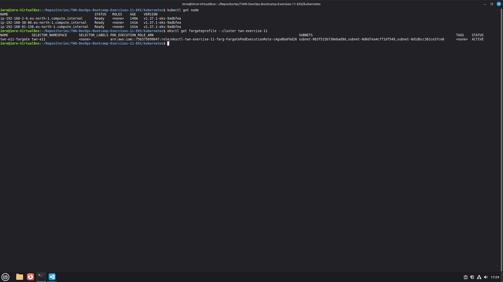
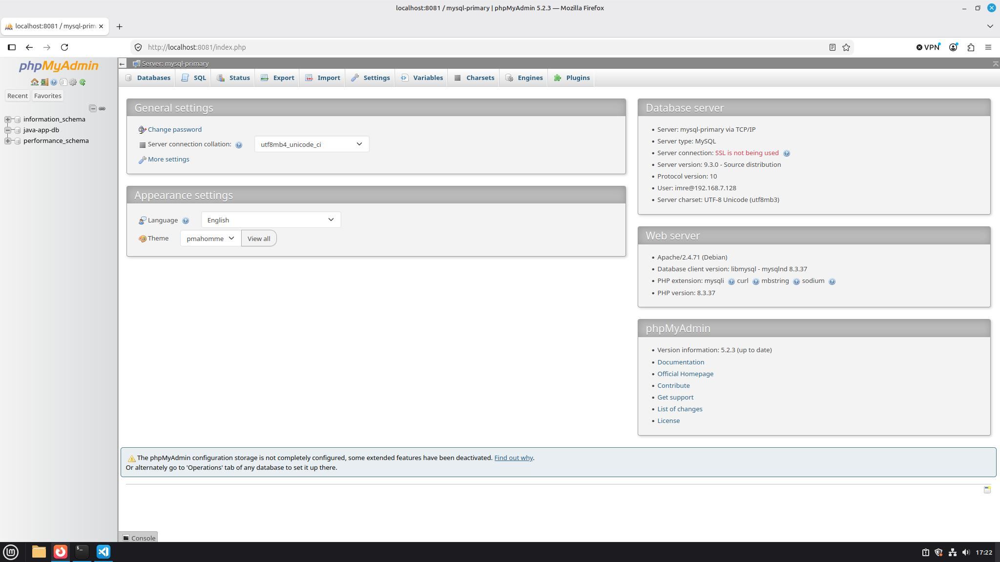
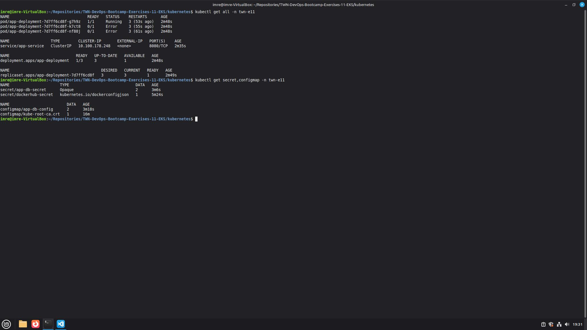

# Solutions for Exercises-10-Kubernetes-on-AWS-EKS

## Exercise 1

**At first I installed EKSCTL to my virtual machine (Linux Mint):**

```bash
ARCH=amd64
PLATFORM=$(uname -s)_$ARCH

curl -sLO "https://github.com/eksctl-io/eksctl/releases/latest/download/eksctl_$PLATFORM.tar.gz"

tar -xzf eksctl_$PLATFORM.tar.gz -C /tmp && rm eksctl_$PLATFORM.tar.gz

sudo install -m 0755 /tmp/eksctl /usr/local/bin && rm /tmp/eksctl

eksctl version
```

**Next I created the cluster itself:**

```bash
eksctl create cluster --name=twn-exercise-11 --node-type=t3.small --nodes=3 --nodegroup-name=twn-e11-nodes --region=eu-north-1 --kubeconfig=./kubeconfig.twn-e11.yaml
export KUBECONFIG=/home/imre/kubeconfig.twn-e11.yaml
eksctl create fargateprofile --name twn-e11-fargate --namespace twn-e11 --cluster twn-exercise-11

kubectl get node
eksctl get fargateprofile --cluster twn-exercise-11
```

**The new cluster and the Fargate profile:**



## Exercise 2

**I installed MySql from Helm Chart:**

```bash
cd ~/Repositories/TWN-DevOps-Bootcamp-Exercises-11-EKS/kubernetes

helm install mysql oci://registry-1.docker.io/bitnamicharts/mysql -f mysql-helm-values.yaml

helm list
kubectl get all
```

**I deployed PhpMyAdmin:**

```bash
kubectl apply -f app-configmap.yaml
kubectl apply -f phpmyadmin-deployment.yaml

kubectl get all

kubectl port-forward service/phpmyadmin-service 8081:8081
```

**The port-forwarded PhpMyAdmin page in browser:**



## Exercise 3

**At first I created a new namespace for the Fargate profile:**

```bash
kubectl create namespace twn-e11
```

**After that I needed to create a secret for pulling the app's image from my private repository:**

```bash
kubectl create secret docker-registry dockerhub-secret --docker-email=DOCKER_MAIL_ADDRESS --docker-username=bodnarimredocker --docker-password=DOCKER_PASSWORD --docker-server=https://index.docker.io/v1/ -n twn-e11
```

**Lastly I deployed the remaining parts of the application:**

```bash
kubectl apply -f app-configmap.yaml -n twn-e11
kubectl apply -f app-secret.yaml -n twn-e11
kubectl apply -f app-deployment.yaml -n twn-e11
kubectl apply -f app-service.yaml -n twn-e11

kubectl get all -n twn-e11
kubectl get secret,configmap -n twn-e11
```

**All the deployed components:**


